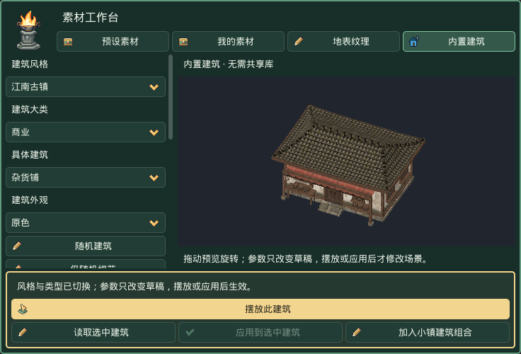
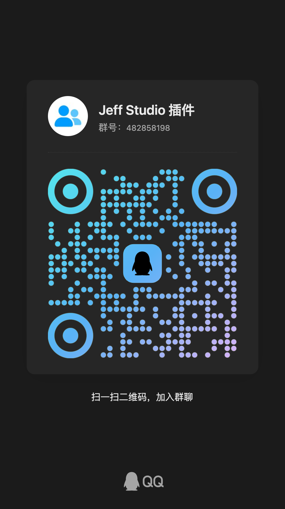

# Jeff Studio Godot 场景插件

**在 Godot 中制作 HD-2D 地形、建筑、小镇和昼夜天气。**

Jeff Studio Scene 将地形、一键生成、素材、铺设、角色、镜头、环境和音乐集中在编辑器中，提供中文／英文界面。

[下载 0.4.7.1](https://github.com/Smidle/jeff-studio-scene/releases/tag/v0.4.7.1) · [中文说明书](manual/zh/index.md) · [English Manual](manual/en/index.md) · [更新说明](manual/zh/release_notes.md) · [反馈问题](https://github.com/Smidle/jeff-studio-scene/issues)

## 0.4.7.1 修复

- 新生成的建筑、小镇地形和道路／围墙网格自动使用工程内的压缩 `.res`，减少 `.tscn` 重复嵌入数据。
- 旧场景可通过 **素材 → 导入与检查 → 优化场景文件** 一次转存；先自动备份，再由用户保存。移动或备份工程时保留 `hd2d_generated`。
- 地表八层占满时，自动道路改用贴地像素网格，继续蓝图摆放，保留已有纹理。
- 更新中英文说明书。仅交付插件与说明书，不含本地测试内容。

## 0.4.7 新增与优化

- **昼夜系统**：24 小时开始时间、自动循环、昼夜时长、夜间补光和月光。
- **天气系统**：雨、雪、雾、沙尘暴、雷雨、秋日枫叶和春日樱花；三维天气、屋顶遮雨、室内遮挡盒、水花、整片地表同步湿润、可选 Sky3D 像素天空。
- **花叶专用设置**：数量、大小、出现节奏、下落速度差异、飘摆、翻转和随机种子。雨雪大小及雷雨闪电频率、时长可调。
- **九种建筑风格**：原江南、欧式、沙漠之外，新增日式町屋、北欧雪乡、热带海港、中式宫阙、哥特城镇和蒸汽工业。沿用 10 大类、46 个功能类型。
- **Blender 导出**：工作台当前内置建筑可导出含贴图与材质的 GLB。
- **操作修订**：环境模块固定金色应用区；小镇默认双排、间隔更紧凑；放置角色时自动补建缺失容器，支持撤销。

完整差异见 [0.4.6 → 0.4.7](manual/zh/release_notes.md)。多云与暴风雪未纳入最终版本。

## 安装

1. 在 [Release](https://github.com/Smidle/jeff-studio-scene/releases/tag/v0.4.7.1) 下载 `01_HD2D_0.4.7.1_Plugin_Manual.zip`。
2. 关闭 Godot 并备份旧插件，把解压后的 `addons/hd2d_scene_tools` 放入自己的 Godot 工程。
3. 等待资源导入，在 **项目 → 项目设置 → 插件** 启用 **Jeff Studio Scene**。
4. 点击 **新建地图** 开始制作；说明书留在工程外，浏览器打开 `START_HERE.html`。

已验证 **Godot 4.7.2 / Compatibility、Forward+**。本仓库不是独立游戏工程，不附带或覆盖 `project.godot`。

## 内容范围

内置建筑、35 张原创地表纹理及 14 套方案可直接使用。共享素材库可选，本仓库和 Release **不包含共享素材库、案例、任何本地测试场景、生成缓存或提取角色图片／索引**。角色导入、动画、身份和放置功能保留，可使用自有素材或兼容的外部角色库。

[分发说明](manual/DISTRIBUTION.md) · [第三方许可与署名](THIRD_PARTY_NOTICES.md)。原有场景不会自动重建；新建舞台默认开启三维天气增强，旧场景可手动开启并应用。

## English

Jeff Studio Scene is a bilingual Godot HD-2D authoring addon. Version **0.4.7.1** fixes generated-resource storage and full-layer paving fallback. New generated scenes use compressed external resources automatically; old scenes have a one-time Optimize Scene File action. It retains the **0.4.7** features: a 24-hour day/night cycle, enhanced 3D weather, leaf/petal randomness controls, six additional architectural styles (nine total), textured GLB export for Blender, compact double-row towns and automatic character-container creation.

Install only `addons/hd2d_scene_tools` into an existing Godot project and enable the plugin. Verified on Godot 4.7.2 with Compatibility and Forward+. This public distribution includes the plugin, original built-in assets and manuals only; shared libraries, cases, local tests, caches and extracted character artwork are excluded.

[English manual](manual/en/index.md) · [English release notes](manual/en/release_notes.md).

## 许可 / License

插件代码沿用 [MIT License](LICENSE)。Sky3D 及其纹理保留各自许可证和署名，详见 [THIRD_PARTY_NOTICES.md](THIRD_PARTY_NOTICES.md)。

## 交流群 / Community

欢迎交流插件使用、作品与反馈，自愿加入。/ Join the community to discuss the plugin, share your work and give feedback. Joining is optional.

| 微信：Jeff Studio 内测群 / WeChat | QQ：Jeff Studio 插件 |
| :---: | :---: |
|  |  |
| 原图注明：**11 月 4 日前有效**。/ Valid before **November 4**, as stated in the image. | 群号 / Group number: **482858198** |

点击图片查看原图。/ Click an image to view the original at full resolution.
