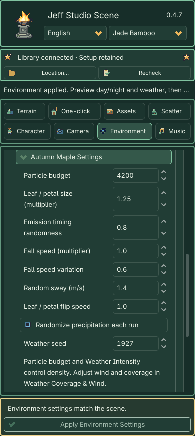
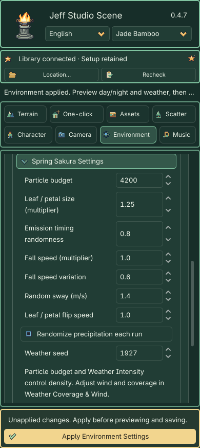
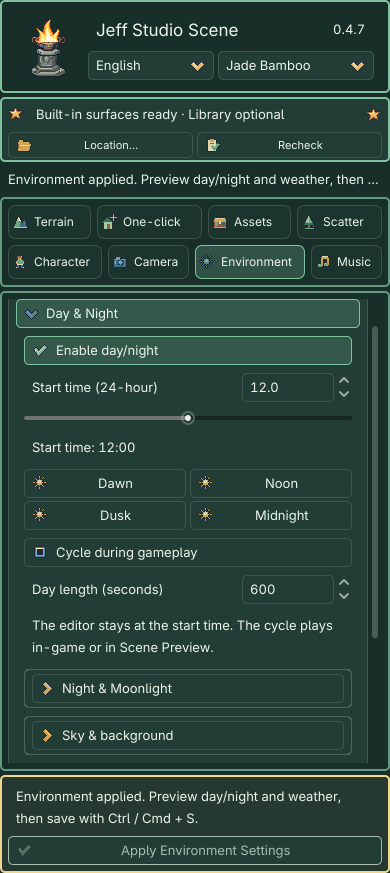
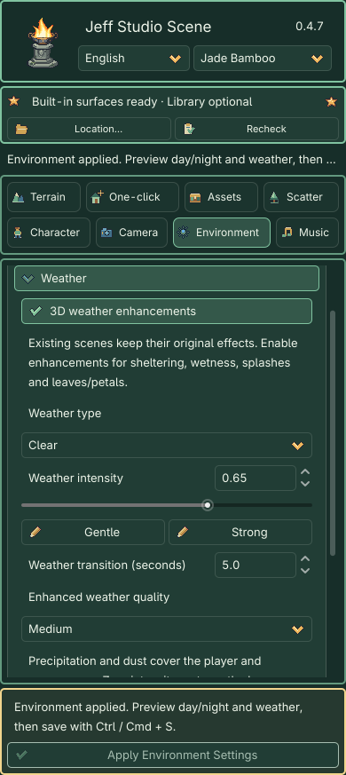
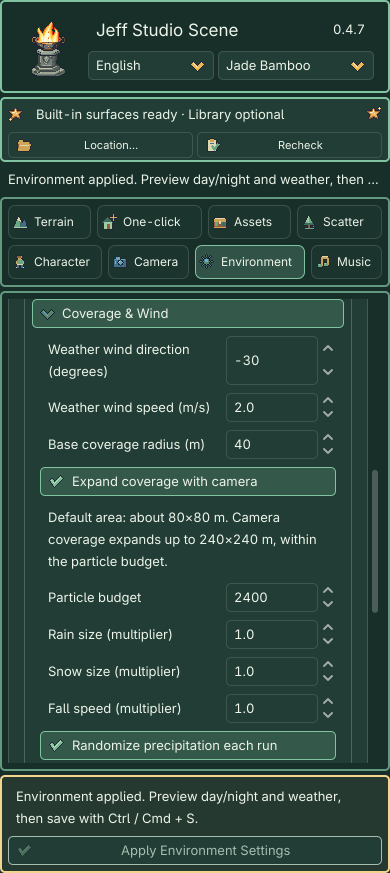
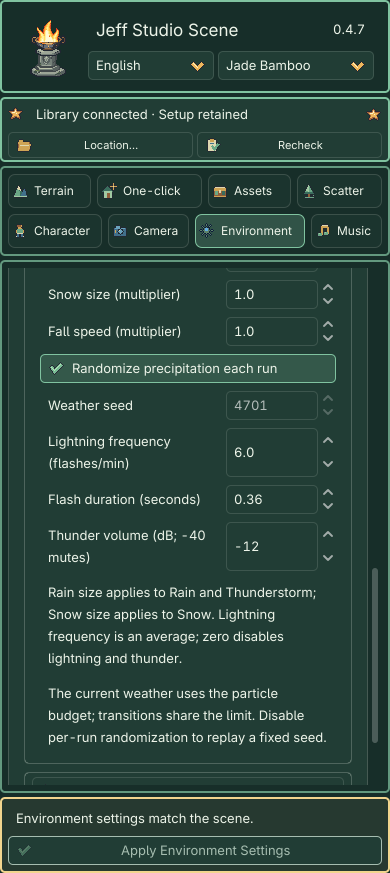
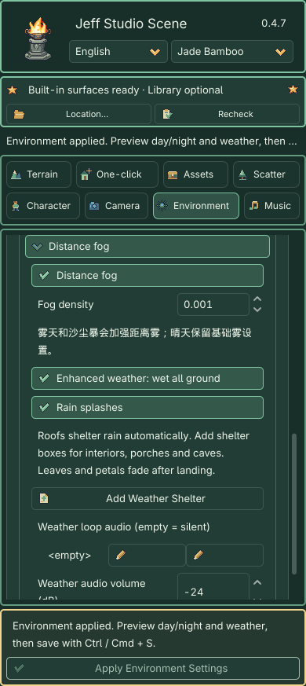

# Environment: Day/Night and Weather

> Public 0.4.7.1 · Plugin and manual only. No extracted character sheets, shared-library payloads, cases or local test projects are bundled.

## 3D weather enhancements (0.4.7)

These weather enhancements are included in 0.4.7. Existing scenes retain their original weather. Newly created stages enable **3D weather enhancements**. Changing this setting still requires **Apply Environment Settings** and supports one undo.

1. Select the stage, open **Environment → Weather**, enable **3D weather enhancements**, choose the weather, intensity and quality, then Apply.
2. Rain, Snow, Fog, Sandstorm and Thunderstorm remain. Blizzard is removed; saved ID 7 falls back to Clear. **Autumn Maple / Spring Sakura** are mutually exclusive weather presets. Selecting either enables enhancements in the draft. Each atlas provides three shapes and eight flip frames. Pieces flutter in the air, align with the surface on contact, stop rotating and changing frames, then fade over about 1.5 seconds.
3. Rain/snow size and fall speed are in **Coverage & Wind**. For leaves/petals, use **Autumn Maple Settings / Spring Sakura Settings** for count, size and random motion. Runtime weather changes blend over five seconds by default; zero switches immediately. Gentle / Strong only changes intensity.
4. Ordinary roofs participate in a local collision heightfield. For interiors, porches and caves, use **Add Weather Shelter** in the fog group. Move, rotate or scale the wireframe; edit `size` in the native Inspector. Creation has its own undo and the box saves with the scene, without modifying character physics. Entering a shelter leaves outdoor weather visible through windows.
5. Enable **Enhanced weather: wet all ground**. Built-in terrain and layered ground become wet uniformly, ignoring roofs, shelter boxes and the particle coverage area, then dry together after rain. This creates no real puddles. **Rain splashes** still appear only on exposed surface hits; particle shelter remains active.
6. **Day & Night → Sky & Background → Enhanced sky source** offers **Sky3D pixel sky**. Original environment remains the default. Both use the same stage clock, without an extra screen-space fog or volumetric fog layer.
7. Apply, inspect **Camera → Preview Scene**, then save. Weather loop audio accepts an AudioStream; empty is silent. The existing synthesized thunder remains controlled by Thunder Volume.

The default is Medium quality and a total particle budget of 2400, capped at 6000. Rain, snow, leaves, transition effects and splashes share this budget. The active weather uses the available budget; transitions share it. Quality controls collision resolution and splash capacity, without silently capping the chosen count. Up to 16 nearby shelter boxes are selected, prioritizing camera-containing and nearby regions; overflow is reported. A heightfield represents only the top surface: complex multilevel interiors also require shelter boxes.

Foliage wind linking preserves each object's sway amount and off setting. Custom materials are not replaced. Seasonal tree replacement, footprints, automatic scheduling and separate multi-camera weather are outside this revision. Sandstorm retains its original particle implementation. Cloudy remains removed; saved ID 1 still behaves as Clear.

Sandstorm keeps its original behavior and does not use the new per-particle exclusion boxes. Visible density also depends on intensity, coverage area and shelter; not every reserved slot is visible simultaneously.

The original controls below remain applicable to scenes with enhancements disabled. Statements excluding wet surfaces and per-particle collision describe that original path only.

Version 0.4.7 organizes Environment into **Day & Night, Weather, and Other Environment Settings**. Select the stage root, adjust a draft, then click the gold **Apply Environment Settings** button fixed below the scrolling controls.

Switching modules preserves the draft. Apply creates one undo/redo action; save with **Ctrl / Cmd + S**. Switching scenes or externally editing the environment synchronizes the target and reports the change. Existing scenes default to day/night disabled and Clear weather, preserving their static lighting.

### Particle count and random distribution

1. Select the stage root, open **Environment → Weather**, and choose **Autumn Maple** or **Spring Sakura**. Its dedicated settings section appears below.
2. **Particle budget** (100–6000) sets the active weather's upper limit. **Weather intensity** controls density; a larger coverage area makes the same budget look sparser. Zero intensity hides the effect. Budget is not the number visible on screen at once.
3. Adjust the dedicated controls below. Maple and Sakura share the stage's leaf/petal parameters; switching weather retains these values.

| Control | Default | Effect |
|---|---:|---|
| Leaf/petal size | 1 | Individual size, independent of count. |
| Emission timing randomness | 0.5 | 0 emits evenly; 1 gives a more irregular rhythm. Spawn positions remain seeded and random. |
| Fall speed | 1 | Overall falling speed multiplier. |
| Fall speed variation | 0.25 | Each particle varies by ±25% around the base speed. 0 gives uniform speed; maximum 0.9 is ±90%. |
| Random sway (m/s) | 0.7 | Side-to-side flutter with different phases per particle. 0 disables flutter; wind still applies. |
| Leaf/petal flip speed | 1 | Flipping animation speed; 0 stops flipping. |

4. **Randomize precipitation each run** defaults on for a fresh distribution each run or newly opened preview. Disable it to edit **Weather random seed**. Matching seed and settings reproduce initial positions, shapes and movement phases. Count, size and motion adjustments do not reroll the current run's seed.
5. Click the fixed gold **Apply Environment Settings**, then run or reopen **Camera → Preview Current Scene**. Allow a few seconds for emission/count changes; existing particles receive speed variation when reborn. Save with **Ctrl / Cmd + S**. One undo restores the applied environment change.

For gentle petals, try budget 1200, intensity 0.5, timing randomness 0.6, speed variation 0.25 and sway 0.5. Wind direction, wind speed and coverage remain under **Weather Coverage & Wind**.

## Current 0.4.7 controls

Edit the draft, then use the fixed Apply button. The images locate coverage, particle size, lightning and wet-ground controls.

## Quick workflow

1. **Fixed dusk:** Open Day & Night, click Dusk, then Apply. This selects 18:00. Leave Cycle during gameplay off to hold that time.
2. **Automatic cycle:** Enable day/night and Cycle during gameplay, set Start time to 12 and Day length to 600 seconds, then Apply. Open **Camera → Preview Scene** to run a full day in ten minutes. The editor stays at the start time for scene authoring.
3. **Precipitation:** Choose Rain or Snow and intensity 0.65, then Apply and Preview. Choose Clear to stop precipitation. Weather can combine with any time, including midnight rain.
4. **Save:** Preview time and character movement never write back to the source scene. Close Preview and save the applied settings. Unapplied drafts are not used by Preview.

## Day & Night

| Setting | Default | Purpose |
|---|---:|---|
| Enable day/night | Off | Time drives sun elevation, sky, sun and moon lighting. Disable to restore static lighting. |
| Start time (24-hour) | 12 | 0–23.99, also displayed as hours/minutes. Dawn / Noon / Dusk / Midnight select 6 / 12 / 18 / 0. |
| Cycle during gameplay | Off | Advance time in-game or in isolated Scene Preview. Off holds the selected hour. |
| Day length (seconds) | 600 | 30–7200 seconds for a full 24 hours. Preview pause freezes the clock and precipitation. |

Lighting transitions smoothly across sunrise, sunset and midnight. Apply restarts from the selected hour. Saving stores the start time and cycle settings, not the running clock.

### Night & Moonlight

Night fill defaults to **0.12**, moonlight energy to **0.18**, night sky to `#0c1733`, and night horizon to `#27314c`. Raise night fill to improve readability, then moonlight for stronger directional illumination. Cast Shadows controls both sunlight and moonlight shadows.

### Sky & Background

Procedural Sky and Background Color remain available. Day sky and horizon define the daytime base; Night & Moonlight defines night colors. This does not generate a physical sky model.

### Sun & Shadows

Sun color, energy and azimuth remain adjustable. **Static sun elevation** is editable only when day/night is off. With day/night on, the clock controls elevation. Selecting a time does not overwrite the scene's base sunlight values.

### Ambient Fill

Adjust the color and brightness of daytime shadowed surfaces. With day/night enabled this blends toward Night fill. Excessive ambient fill reduces architectural contrast.

## Weather

| Type | Effect |
|---|---|
| Clear | Base lighting without precipitation. |
| Rain | Rainy lighting and pixel streaks affected by precipitation wind direction/speed. |
| Snow | Cool haze and slowly falling pixel snowflakes. |
| Fog | Dense cool distance haze, without precipitation particles. |
| Sandstorm | Warm dusty haze and sideways dust; minimum wind speed 9 m/s. |
| Thunderstorm | Dark rain, intermittent lightning and delayed thunder, with adjustable flash frequency and duration. |

Intensity ranges from **0 to 1**, default **0.65**, affecting atmosphere and particle count. Zero removes weather effects and restores the base environment for the current time.

Cloudy has been removed. Saved Cloudy scenes fall back to Clear; other saved weather IDs retain their meaning.

### Coverage & Wind

| Setting | Default | Advice |
|---|---:|---|
| Weather wind direction (degrees) | -30 | -180–180 in the world X/Z plane. |
| Weather wind speed (m/s) | 2 | 0–10; independent of plant wind. Storm presets enforce a minimum wind. |
| Base coverage radius (m) | 40 | 8–120. About 80×80 m horizontally by default, increased from 48×48 m. Follows the player, or the camera rig without a player. |
| Expand coverage with camera | On | Uses camera-to-ground intersections, up to about 240×240 m. Off uses the base range. An extra upwind margin feeds incoming particles. |
| Particle budget | 2400 | 100–6000. Density scales with area and intensity, capped at this limit. Extreme zoom-out becomes sparser once the budget is reached. |
| Rain size (multiplier) | 1 | 0.25–4; scales the width and length of rain in Rain and Thunderstorm without changing speed, count or coverage. |
| Snow size (multiplier) | 1 | 0.25–4; scales Snow flakes without changing wind or count. |
| Weather seed | 4701 | Initial particle distribution, gust phase and lightning intervals. |
| Lightning frequency (flashes/min) | 6 | 0–20; an average with ±20% interval variation. Default: 8–12 seconds between flashes. Zero disables flashes and thunder, retaining rain. |
| Flash duration (seconds) | 0.36 | 0.05–2; brightness fades smoothly over this duration. |
| Thunder volume (dB; -40 mutes) | -12 | Thunderstorm only. Original synthesized thunder requires no external sound library. |

Size controls are directly below Particle budget; lightning controls are above Thunder volume. Click **Apply Environment Settings**, then preview from Camera.

Precipitation uses scene depth occlusion and works in Compatibility and Forward+ without a shared library. These are outdoor visual effects: **no snow accumulation, puddles, wet-surface material or per-particle roof collision**. Use Clear or zero intensity indoors. Coverage remains local and bounded; views beyond the upper limit are not filled indefinitely. Pausing freezes precipitation, gusts, lightning and thunder. Clear or zero intensity removes them.

### Wind & Cloud Shadows

Cloud Shadow Strength retains legacy plugin-material shading only. It no longer creates the removed Cloudy weather's moving projections.

Existing foliage wind and plugin-material cloud shading remain separate from weather wind. Use Assets for per-instance foliage adjustments.

### Distance Fog

Base fog remains independently adjustable (default density 0.001). Rain and snow add light haze; Fog and Sandstorm add denser weather haze. Clear restores the base settings. This is distance fog, not volumetric fog.

## Other Environment Settings

### Color Adjustments

Saturation defaults to 1.05 and contrast to 1.04; 1 is neutral. Both are committed with the other environment settings by the fixed Apply button.

### Real Depth of Field

Forward+ supports far depth of field. Compatibility disables these controls while keeping the other environment features available. Inspect the result through the scene camera in Preview.

### Presentation Effects

Vignette and screen-zone blur affect the game/isolated Preview, not Godot's native editing viewport. Zone blur is not distance-based DOF. Enable the existing presentation pass to adjust these effects and grading.

### Legacy World Map Environment

For old maps containing `WorldEnvironmentAdapter` only. Regional grading and water/cloud speed retain their separate **Apply World Environment** action. Ordinary maps do not need this group.

## Fixed Apply Area

- **Apply Environment Settings:** Commits the environment draft as one action. Disabled without a scene or changes. It does not rebuild buildings, roads or terrain, or reset the following camera.
- **Status:** Distinguishes pending changes, applied settings awaiting save, saved settings and target synchronization.

The footer contains only Apply and status feedback. To view day/night, precipitation and movement, apply first, then open **Camera → Preview Scene**. This independent scene preview does not commit an environment draft.

The area remains visible while scrolling, collapsing groups or opening the asset workbench. Existing maps can opt into the new features without being rebuilt.

## Actual Interface and Case07 Views

UI captured in Godot 4.7.2 / Compatibility / 0.4.7. The Case07 copy uses the same camera; effect captions identify the renderer.

<strong>Day/night and fixed Apply</strong>

<strong>Weather controls</strong>

<strong>Noon / Compatibility</strong>

<strong>Midnight / Compatibility</strong>

<strong>Rain / Forward+</strong>

<strong>Snow / Forward+</strong>

## New Weather: Actual Case07 Captures

Same wide camera at weather intensity 0.85; no weather was added in post-production. Fog and Sandstorm use Compatibility; the remaining captures use Forward+.

<strong>Fog</strong>

<strong>Sandstorm</strong>

<strong>Thunderstorm</strong>

<strong>Lightning during a thunderstorm</strong>

[← Manual contents](../index.md) · [Release notes](../release_notes.md)
