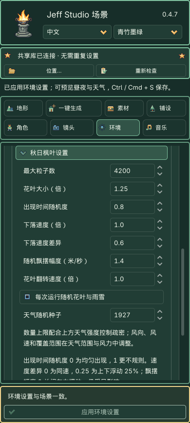
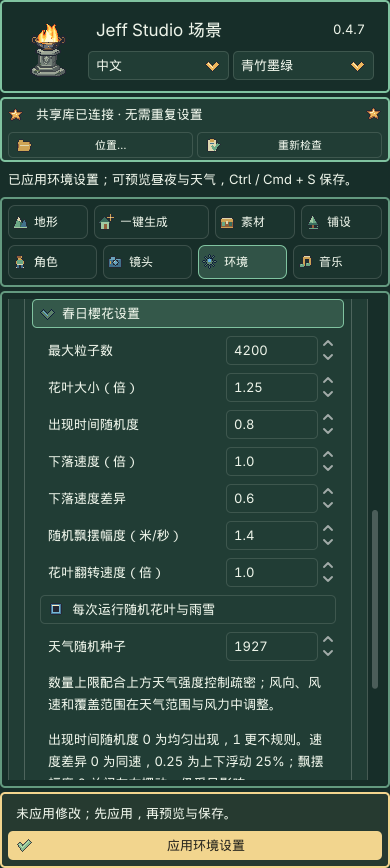
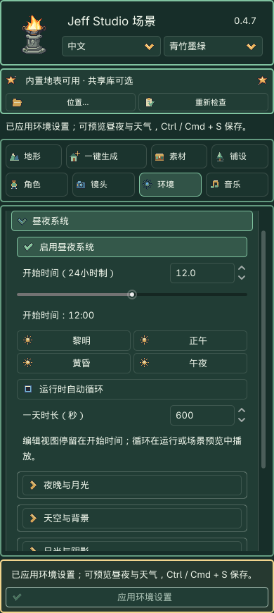
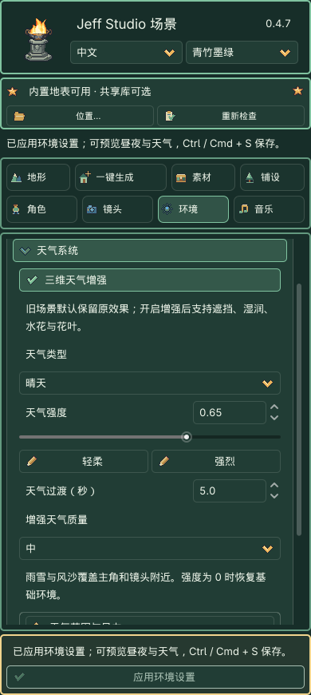
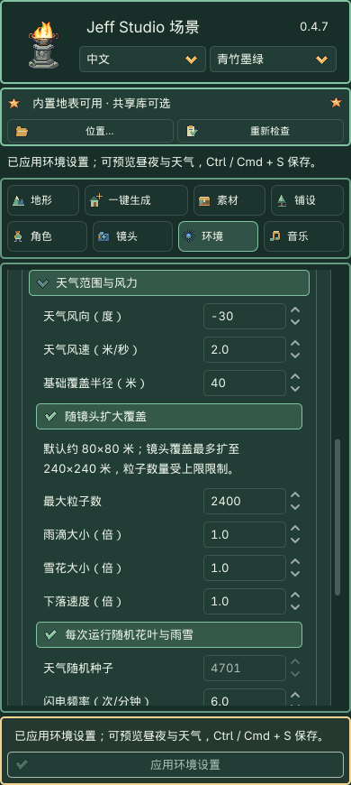
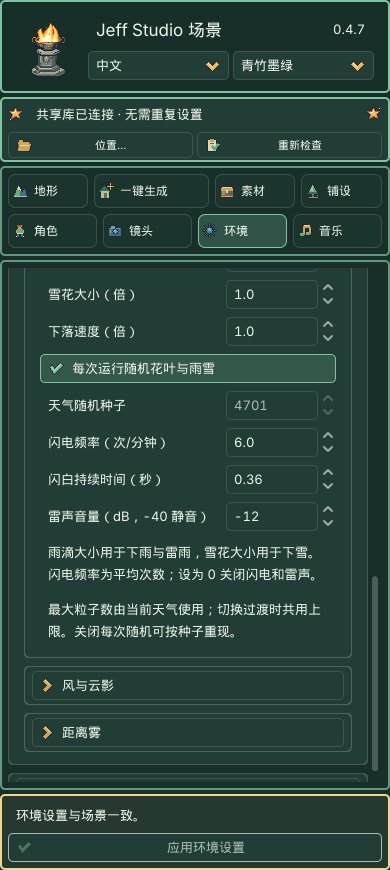
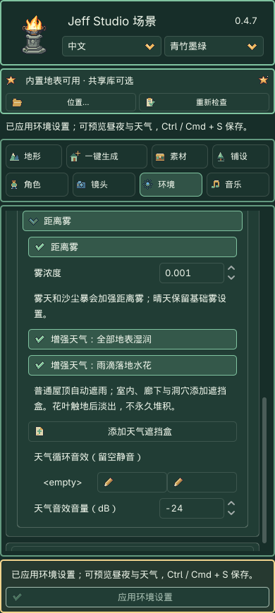

# 环境：昼夜与天气

> 公开版 0.4.7.1 · 仅插件与说明书，不附带提取角色图片、共享素材库、案例或本地测试工程。

## 三维天气增强（0.4.7）

本节介绍 0.4.7 的三维天气功能。旧场景默认沿用原效果，新建舞台默认开启 **三维天气增强**。开启或关闭增强仍需点击底部 **应用环境设置**，并支持一次撤销。

1. 选中舞台根节点，展开 **环境 → 天气系统**，勾选 **三维天气增强**。选择天气、强度和质量，然后应用。
2. 保留下雨、下雪、雾天、沙尘暴和雷雨；暴风雪已移除，旧编号 7 按晴天处理；新增 **秋日枫叶／春日樱花**，与雨雪互斥。选择花叶会在草稿中自动开启增强。花叶有三种外形、八帧翻转；空中随风飘动，触地后贴合表面并停止旋转和翻帧，在约 1.5 秒内淡出。
3. 雨雪在 **天气范围与风力** 调整粒子大小和下落速度；选择花叶后，在 **秋日枫叶设置／春日樱花设置** 调整数量、大小和随机运动。运行中切换天气默认渐变 5 秒，0 秒直接切换；“轻柔／强烈”只修改强度。
4. 普通屋顶自动参与高度场遮雨。室内、廊下和洞穴从距离雾组点击 **添加天气遮挡盒**，移动、旋转或缩放线框，原生检查器的 `size` 修改尺寸。盒子创建有独立撤销，配置随场景保存；它不改变人物物理碰撞。相机进入盒子不会隐藏窗外天气。
5. 开启 **增强天气：全部地表湿润**，整片内置地形和分层地面同步渐湿，忽略屋顶、遮挡盒和粒子覆盖范围。雨停后一起逐渐干燥；不生成真实积水。**雨滴落地水花**仍仅在露天命中处生成，天气遮挡仍用于雨雪粒子。
6. 在 **昼夜 → 天空与背景 → 增强天空来源** 可选 **Sky3D 像素天空**；默认沿用原环境。时间仍使用本页唯一的昼夜设置，天空不额外开启屏幕雾或体积雾。
7. 应用后从 **镜头 → 预览当前场景** 检查，再保存。天气循环音效支持自选 AudioStream，留空静音；雷雨原有程序雷声仍由雷声音量控制。

增强默认中档、总粒子预算 2400；雨雪、花叶、过渡效果和水花共同受预算约束，最高 6000。最大粒子数优先分配给当前天气，过渡期间由前后天气共用；低／中／高只影响碰撞分辨率和水花容量，不再偷偷压低粒子数量。每个主相机附近最多选择 16 个遮挡盒，优先包含相机的区域和近处区域；超限会报告提示。单层高度场无法表达复杂多层室内，必须配合遮挡盒。

“天气联动植物风”保留物件自身的风摆开关和幅度。自定义材质不会被替换；本次不包含树木换季、脚印、自动天气排程或多相机独立天气。沙尘暴沿用原粒子实现。多云仍不提供，旧编号 1 继续按晴天处理。

沙尘暴为保持原效果，继续使用原路径，不应用新增的逐粒子排除盒。粒子数还受天气强度、镜头覆盖面积和遮挡影响，并非每个预算槽都同时出现在画面里。

以下原有参数与操作仍适用于关闭增强的场景；其中“不包含湿润／逐粒子碰撞”的说明仅指原天气路径。

0.4.7 将环境页整理为 **昼夜系统、天气系统、其他环境设置**。先选中场景的舞台根节点，再调整参数，最后点击侧栏底部金色 **应用环境设置**。底部方框固定在滚动区域外。

调整控件只改变草稿；切换模块不会丢失草稿。应用后可一次撤销／重做，**Ctrl / Cmd + S** 保存。切换场景或在其他位置修改环境，会同步新目标并提示。旧场景默认关闭昼夜、天气为晴天，原有光照保持不变。

### 粒子数量与随机分布

1. 选中舞台根节点，打开 **环境 → 天气系统**，天气选 **秋日枫叶** 或 **春日樱花**。下方只显示对应的专用设置区。
2. 调 **最大粒子数**（100–6000）控制当前天气的数量上限；上方 **天气强度** 控制疏密。同样数量下，覆盖面积越大，画面越稀疏；强度为 0 则不显示。数量上限不等于屏幕同时可见数量。
3. 在专用区调整下面的参数。枫叶／樱花共用当前舞台的花叶参数，切换天气不重置数值。

| 参数 | 默认值 | 效果 |
|---|---:|---|
| 花叶大小（倍） | 1 | 单片大小，不改变数量。 |
| 出现时间随机度 | 0.5 | 0 为均匀发射，1 为更不规则的出现节奏；出生位置始终按种子随机分布。 |
| 下落速度（倍） | 1 | 所有花叶的整体速度。 |
| 下落速度差异 | 0.25 | 每片在基准速度上下浮动 25%；0 为同速，最高 0.9（±90%）。 |
| 随机飘摆幅度（米/秒） | 0.7 | 各片以不同相位左右飘摆；0 关闭飘摆，仍受风向与风速影响。 |
| 花叶翻转速度（倍） | 1 | 翻转动画速度；0 停止翻转。 |

4. **每次运行随机花叶与雨雪** 默认开启，每次运行或新开预览换一个分布。关闭后设置 **天气随机种子**，相同参数和种子可重现初始位置、形状及运动相位。只改数量、大小或运动参数不重新抽取本次种子。
5. 点击底部金色 **应用环境设置**，再运行场景或从 **镜头 → 预览当前场景** 重新预览。数量和发射节奏变化需要几秒显现，已有粒子的速度差异会在重新出生后更新。**Ctrl / Cmd + S** 保存；一次撤销可以还原本次环境修改。

建议轻柔樱花从数量 1200、强度 0.5、时间随机度 0.6、速度差异 0.25、飘摆幅度 0.5 开始；增加数量和强度可变得更密。风向、风速和覆盖范围仍在 **天气范围与风力**。

## 0.4.7 当前操作界面

先填写草稿，再用固定底部应用按钮提交。天气覆盖、粒子大小、闪电和地表湿润分别见下图。

## 快速操作

1. **固定黄昏：** 展开“昼夜系统”，点击“黄昏”，再应用。时间为 18:00；关闭“运行时自动循环”即可一直保持该时刻。
2. **自动昼夜：** 开启“启用昼夜系统”和“运行时自动循环”，开始时间设为 12，一天时长设为 600 秒，再应用。切到 **镜头 → 预览当前场景**，10 分钟走完一天。编辑视图保持开始时间，方便布景。
3. **雨雪：** 在“天气系统”选择“下雨”或“下雪”，强度设为 0.65，再应用和预览。切换“晴天”可停止雨雪。天气与昼夜可以组合，例如午夜下雨。
4. **检查并保存：** 预览里的时间与角色移动不写回源场景。关闭预览，确认底部显示已应用后保存。未应用草稿不会进入预览。

## 昼夜系统

| 参数 | 默认值 | 用途 |
|---|---:|---|
| 启用昼夜系统 | 关闭 | 开启后由时间控制太阳高度、天空、日光和月光；关闭后恢复静态环境。 |
| 开始时间（24小时制） | 12 | 0–23.99；下方显示时分。黎明／正午／黄昏／午夜分别为 6／12／18／0 点。 |
| 运行时自动循环 | 关闭 | 运行或隔离场景预览中推进时间；不开启则使用固定时刻。 |
| 一天时长（秒） | 600 | 30–7200 秒对应完整 24 小时。预览暂停会同时暂停时钟和雨雪。 |

白天到夜晚平滑过渡，午夜循环不跳色。每次应用从选定的开始时间重新播放；保存的是开始时间和循环设置，运行中的时钟不回写场景。

### 夜晚与月光

夜间补光默认 **0.12**，月光强度 **0.18**。夜空默认 `#0c1733`，夜晚地平线 `#27314c`。夜景过暗时先适量增加夜间补光；需要明显的照射方向时再调整月光。关闭“投射阴影”会同时关闭日光与月光阴影。

### 天空与背景

保留程序天空和背景色两种模式。白天天空及地平线作为日间基准；夜空颜色在“夜晚与月光”中设置。这里不会生成实体天空模型。

### 日光与阴影

日光颜色、强度和太阳方位继续可调。**太阳高度（静态）** 仅在昼夜关闭时可改；开启后由时钟控制，不需要同时调整两套高度。旧场景的日光参数不会被预设覆盖。

### 环境补光

调整白天背光面的颜色和亮度。昼夜开启时，白天补光会与夜间补光渐变。补光过高会削弱建筑的明暗层次。

## 天气系统

| 天气 | 效果 |
|---|---|
| 晴天 | 使用基础环境，不生成雨雪。 |
| 下雨 | 阴雨光照及像素雨线，受雨雪风向和速度影响。 |
| 下雪 | 冷色轻雾及缓慢飘落的像素雪花。 |
| 雾天 | 冷灰色浓雾，降低远处能见度，不生成雨雪粒子。 |
| 沙尘暴 | 暖黄色雾气与横向风沙，自带至少 9 米/秒的风。 |
| 雷雨 | 阴暗雨幕、间歇闪电和延迟雷声；闪电频率和闪白时长可调。 |

天气强度为 **0–1**，默认 **0.65**，同时影响气氛和粒子数量。设为 0 会移除天气效果，恢复当前时刻的基础环境。

多云天气已移除；旧场景保存的多云设置按晴天显示。其他天气的保存编号不变。

### 天气范围与风力

| 参数 | 默认值 | 调整建议 |
|---|---:|---|
| 天气风向（度） | -30 | -180–180；控制世界 X/Z 平面内的吹动方向。 |
| 天气风速（米/秒） | 2 | 0–10；与“植物风力”分开，风暴天气有最低风速。 |
| 基础覆盖半径（米） | 40 | 8–120；默认水平发射范围约 80×80 米，原默认约 48×48 米。围绕主角，没有主角时使用镜头架位置。 |
| 随镜头扩大覆盖 | 开启 | 按镜头与地面的交点扩大范围，最大约 240×240 米；关闭后使用基础范围。迎风侧另留粒子飘入余量。 |
| 最大粒子数 | 2400 | 100–6000；按范围和强度计算数量，再限制到上限。达到上限后继续拉远会变稀疏。 |
| 雨滴大小（倍） | 1 | 0.25–4；同时缩放雨线的宽与长，适用于下雨和雷雨，不改变数量、速度和覆盖。 |
| 雪花大小（倍） | 1 | 0.25–4；适用于下雪的雪花，不改变风力和数量。 |
| 天气随机种子 | 4701 | 关闭“每次运行随机花叶与雨雪”后，控制可重现的增强粒子分布；原雷雨闪电仍使用此种子。 |
| 闪电频率（次/分钟） | 6 | 0–20；平均次数，间隔有 ±20% 随机变化。默认约 8–12 秒一次；0 关闭闪电及雷声，保留降雨。 |
| 闪白持续时间（秒） | 0.36 | 0.05–2；闪光从亮到暗平滑衰减，数值越大持续越久。 |
| 雷声音量（dB，-40 静音） | -12 | 仅用于雷雨；-40 静音。雷声为插件内程序合成，不需要共享库。 |

雨雪大小位于“最大粒子数”下方；闪电频率和时长位于“雷声音量”上方。调整后点击底部 **应用环境设置**，再到镜头页预览。

雨雪使用场景深度遮挡，无需共享素材库；Compatibility 和 Forward+ 都可用。这是户外视觉天气：**不包含积雪、地面积水、湿润材质或逐粒子的屋顶碰撞**。屋内场景可切换晴天或将强度设为 0。天气仅覆盖主角和镜头附近，极远总览超过上限时不会无限扩展。暂停会同时冻结粒子、阵风、闪电和雷声；晴天或强度为 0 会移除这些效果。

### 风与云影

“云影浓度”只保留旧版插件材质的明暗变化，不再生成多云天气的移动投影。

原有植物风力及插件地表材质云影仍保留，与天气横风分开。只修改某一个物件的风摆，请使用素材页的单件参数。

### 距离雾

基础距离雾可单独开启并调整浓度，默认 0.001。雨雪叠加轻雾；雾天和沙尘暴使用更浓的距离雾。晴天恢复基础设置。这不是体积雾。

## 其他环境设置

### 调色

饱和度默认 1.05，对比度默认 1.04；1 为中性值。与其他环境参数一起通过底部按钮应用。

### 真实景深

Forward+ 支持远景景深；Compatibility 控件禁用，其他环境功能仍可使用。景深依赖场景镜头，最终效果请在预览中检查。

### 演出后期

暗角和分区虚化只作用于游戏／隔离预览，不改变 Godot 的原生编辑视口。分区虚化不是按距离计算的真实景深。开启后可调整原有暗角、虚化与调色参数。

### 旧版大地图环境

仅供带 `WorldEnvironmentAdapter` 的旧版大地图使用，地区调色和水面／云雾速度继续通过自己的 **应用大地图环境** 按钮提交。普通地图不需要配置。

## 固定应用区

- **应用环境设置：** 一次提交本页环境草稿。无场景或没有修改时禁用；不重建建筑、道路或地形，也不改变跟随镜头。
- **状态提示：** 区分未应用、已应用待保存、已保存，以及目标变化后的同步。

底部只保留应用按钮与状态提示。需要查看昼夜、雨雪及角色行走时，先应用，再从 **镜头 → 预览当前场景** 打开独立副本；预览不会提交环境草稿。

折叠分组、滚动参数或打开底部素材工作台，都不会遮住应用区。旧场景不必重新制作；开启需要的新功能并保存即可。

## 真实界面与案例 07 效果

界面截图来自 Godot 4.7.2 / Compatibility / 0.4.7。案例 07 副本使用相同机位；下方注明各效果的渲染器。

<strong>昼夜与固定应用区</strong>

<strong>天气设置</strong>

<strong>正午 / Compatibility</strong>

<strong>午夜 / Compatibility</strong>

<strong>下雨 / Forward+</strong>

<strong>下雪 / Forward+</strong>

## 新增天气：案例 07 实拍

以下使用同一宽镜头、天气强度 0.85；画面没有添加后期天气。雾天、沙尘暴为 Compatibility，其余为 Forward+。

<strong>雾天</strong>

<strong>沙尘暴</strong>

<strong>雷雨</strong>

<strong>雷雨中的闪电</strong>

[← 说明书目录](../index.md) · [更新说明](../release_notes.md)
